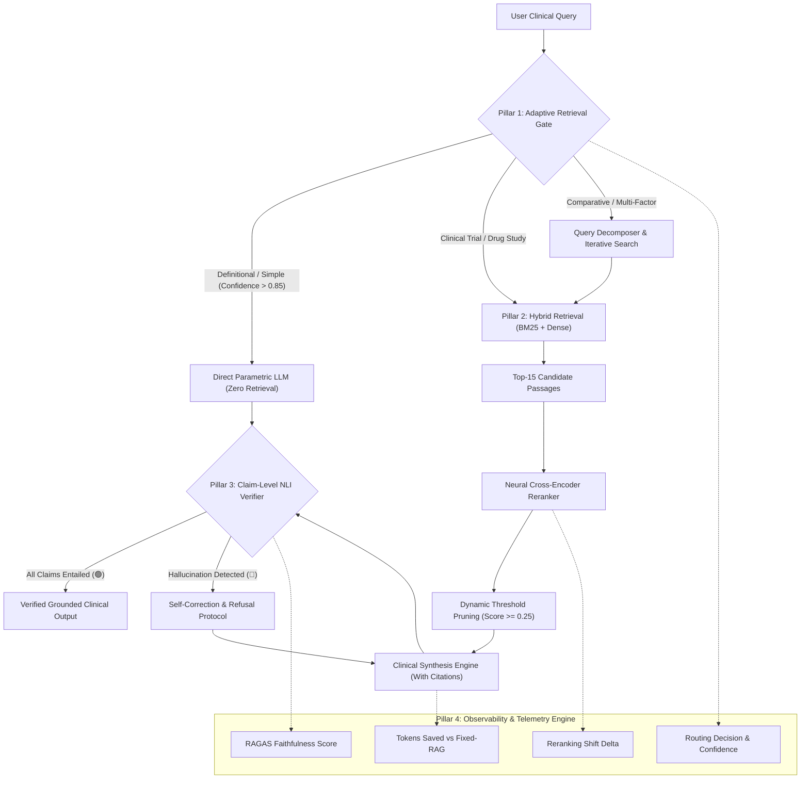
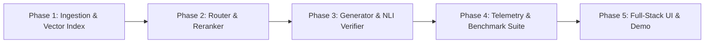

# 🩺 MedVerify: Project Master Plan & Implementation Blueprint
### Retrieval-Augmented Generation with Adaptive Retrieval and Hallucination Detection for Domain QA

> **Document Purpose:** This document is a complete, self-contained overview of our Generative AI project. It explains **what topic we chose**, **why it matters**, **how the architecture works**, **what we will build**, and **how we will execute it together**.

---

## 📑 Table of Contents
1. [Executive Summary (The 30-Second Pitch)](#1-executive-summary)
2. [The Core Problem: Why Standard RAG Fails](#2-the-core-problem-why-standard-rag-fails)
3. [The Solution: How MedVerify Works](#3-the-solution-how-medverify-works)
4. [The 4 Architectural Pillars](#4-the-4-architectural-pillars)
5. [Datasets We Are Using](#5-datasets-we-are-using)
6. [How We Will Prove It Works (The 3-Way Benchmark)](#6-how-we-will-prove-it-works-the-3-way-benchmark)
7. [Tech Stack Options & Decisions to Make](#7-tech-stack-options--decisions-to-make)
8. [Phase-by-Phase Implementation Roadmap](#8-phase-by-phase-implementation-roadmap)
9. [Proposed Work Split (How We Can Divide the Work)](#9-proposed-work-split)

---

## 1. Executive Summary

* **Project Title:** MedVerify — Clinical Evidence Copilot & RAG Guardrails Platform.
* **Academic Topic:** *Retrieval-Augmented Generation with Adaptive Retrieval and Hallucination Detection for Domain QA*.
* **What are we building?** A clinical evidence search and question-answering platform that:
  1. **Decides when to retrieve:** Simple questions are answered directly; complex medical queries trigger targeted document retrieval; comparative queries trigger multi-hop search.
  2. **Reranks candidate evidence:** Uses neural cross-encoders to eliminate noisy or irrelevant medical papers.
  3. **Verifies factual groundedness:** Automatically audits the generated answer sentence-by-sentence using Natural Language Inference (NLI) to detect and correct hallucinations before the user sees them.
  4. **Displays an Observability Telemetry Panel:** An interactive dashboard that shows the routing decision, rank shifts, token savings, and faithfulness scores in real-time.

---

## 2. The Core Problem: Why Standard RAG Fails

Today, most companies and developers build **Naive / Fixed RAG**:
```
User Question ➔ Embed Question ➔ Vector Search Top-5 ➔ Stuff into Prompt ➔ LLM Generates
```

In high-stakes fields like **medicine, law, or finance**, this naive approach breaks down in two critical ways:

### Problem A: "Blind Retrieval" Wastes Money and Adds Noise
Naive RAG retrieves 5 documents for *every single question*, even when retrieval is unnecessary.
* If a doctor asks: *"What is the definition of hypertension?"*
* Naive RAG fetches 5 complex research papers, stuffs 2,000+ tokens into the prompt, increases latency by 2–3 seconds, and costs unnecessary money.
* Furthermore, if the retrieved papers contain irrelevant or conflicting information, they act as **distractors** that confuse the LLM.

### Problem B: Contextual Hallucinations Can Be Dangerous
Even when given the correct medical paper, LLMs frequently hallucinate because:
* Their internal training memory overrides the retrieved document.
* They misquote trial statistics, flip dosages, or invent contraindications.
* In healthcare, giving an ungrounded or contradictory clinical recommendation can be disastrous.

---

## 3. The Solution: How MedVerify Works

MedVerify replaces naive RAG with a **3-stage cognitive guardrail pipeline**:



---

## 4. The 4 Architectural Pillars

### Pillar 1: Adaptive Retrieval Gate (Decide *When* to Retrieve)
Instead of retrieving blindly, an intelligent router analyzes the query:
* **Route 1: `DIRECT_ANSWER` (No-RAG)** — For conceptual definitions (*"What is essential hypertension?"*). Bypasses retrieval to save latency and token costs.
* **Route 2: `CLINICAL_RETRIEVAL` (Single-Hop RAG)** — For specific trial results, efficacy rates, and dosing (*"Does Metformin reduce mortality in CKD stage 3?"*).
* **Route 3: `MULTI_HOP` (Decomposed Search)** — For complex interactions (*"In a patient with eGFR of 35 taking Metformin and Apixaban, what drug interactions occur?"*). Decomposes into sub-queries.

### Pillar 2: Hybrid Retrieval & Cross-Encoder Neural Reranking
* **Hybrid Search:** Combines **BM25 lexical search** (essential for exact drug names, abbreviations like eGFR/POAF, and numbers) with **Dense vector search** (captures semantic intent). Results are merged using **Reciprocal Rank Fusion (RRF)**.
* **Cross-Encoder Reranking:** Bi-encoders (vector search) compare query and document separately. A Cross-Encoder computes joint attention `(query, document)` together, giving an accurate relevance score.
* **Dynamic Pruning:** Automatically drops chunks scoring below a relevance threshold (e.g., $< 0.25$), feeding only high-signal evidence to the LLM.

### Pillar 3: Claim-Level Hallucination Guardrail (NLI Verification)
1. **Sentence Decomposition:** The generated clinical answer is split into individual declarative assertions.
2. **NLI Verification (Natural Language Inference):** Each sentence is tested against the retrieved PubMed abstract:
   * 🟢 **Entailed:** Explicitly supported by the cited study.
   * 🟡 **Extrapolated / Neutral:** General knowledge, not found in the provided study.
   * 🔴 **Contradicted / Unsupported:** Conflicts with the study or is fabricated.
3. **Self-Correction Reflection:** If a red claim is detected, an automated reflection prompt revises the answer before the user sees it, or flags it with a clinical warning.

### Pillar 4: Real-Time Observability Telemetry
A dedicated observability panel that exposes internal telemetry:
* **Decision Gate Latency & Confidence:** Why the system chose to retrieve or skip retrieval.
* **Rank-Shift Delta Chart:** Shows how candidate papers shifted (e.g., Paper A moved from `#8` to `#1` after reranking).
* **Token & Cost Delta:** Live tracking of tokens saved vs. blind Fixed-RAG.
* **Faithfulness Score:** Quantitative score $\frac{\text{Entailed Claims}}{\text{Total Claims}}$.

---

## 5. Datasets We Are Using

We will test and benchmark our pipeline using standard, recognized academic datasets:

| Dataset | Type | Why We Use It |
| :--- | :--- | :--- |
| **PubMedQA** *(Primary)* | Biomedical clinical questions with expert-labeled abstracts & decisions (`yes`/`no`/`maybe`) | Ideal for testing medical hallucination guardrails and strict evidence grounding. |
| **HotpotQA** *(Benchmark)* | Multi-hop question answering across multiple Wikipedia articles | Tests whether our adaptive gate correctly triggers iterative multi-step search. |
| **MS MARCO / Natural Questions** *(Benchmark)* | Large-scale passage ranking and open QA | Standard benchmark for evaluating retrieval and reranking precision. |

---

## 6. How We Will Prove It Works (The 3-Way Benchmark)

To demonstrate clear academic and engineering value, we will evaluate **3 systems side-by-side on the exact same questions**:

| Metric | 1️⃣ No-RAG (Parametric LLM) | 2️⃣ Fixed-RAG (Naive Top-5) | 3️⃣ MedVerify (Our Adaptive Pipeline) |
| :--- | :---: | :---: | :---: |
| **Faithfulness Score (↑)** | Low (~40%) | Moderate (~72%) | **High (> 92%)** 🏆 |
| **Hallucination Rate (↓)** | High (~45%) | Moderate (~20%) | **Near Zero (< 3%)** 🛡️ |
| **Average Tokens / Query (↓)** | ~80 tokens | ~1,850 tokens (Highest) | **~450 tokens (Saved ~65–75%)** 💰 |
| **End-to-End Latency** | ~0.4s | ~2.5s | **~0.8s – 1.2s** ⚡ |
| **Citation Attribution** | None | Blind / Unverified | **Audited `[PMID: ...]` Links** |

---

## 7. Tech Stack Options & Decisions to Make

Because we are starting from scratch, we have the freedom to pick the best modern stack:

### Option A: Python Backend (FastAPI) + Modern Next.js / React Frontend *(Recommended for Portfolio)*
* **Backend:** FastAPI (Python 3.11) exposing `/api/query`, `/api/route`, `/api/benchmark`.
* **Frontend:** Next.js 14 / React with TailwindCSS, Shadcn UI, and Lucide icons (looks like a sleek SaaS product).
* **Orchestration:** LangGraph or custom modular Python services.
* **Vector DB:** Pinecone, Qdrant Cloud, or Local Hybrid ChromaDB + BM25.
* **LLM Engine:** Google Gemini API (`gemini-2.5-flash`) or OpenAI (`gpt-4o-mini`).

### Option B: All-in-One Python Framework (FastAPI + Streamlit / Gradio) *(Fastest to Build)*
* **Backend & UI:** Python Streamlit / Reflex with custom dark glassmorphic CSS.
* **Advantage:** Faster iteration, no JavaScript/React context switching.

### Key Vector Database Choices:
* **Local Hybrid (Default):** BM25 + Sentence Transformers (`all-MiniLM-L6-v2`) — 100% free, runs offline, zero API keys required.
* **Cloud Vector DB (Pinecone / Qdrant):** Cloud-hosted vector search with managed indexing.

---

## 8. Phase-by-Phase Implementation Roadmap



* **Phase 1: Dataset Ingestion & Hybrid Indexing**
  * Download and parse the PubMedQA expert-labeled dataset.
  * Build the BM25 sparse index + dense vector index.
* **Phase 2: Adaptive Router & Cross-Encoder Reranker**
  * Implement the classification logic: Direct Answer vs. Single-Hop vs. Multi-Hop.
  * Implement the Cross-Encoder reranker with score threshold pruning.
* **Phase 3: Clinical Synthesis & Hallucination Guardrail**
  * Prompt engineering for evidence-grounded generation with explicit citations.
  * Claim extraction and NLI entailment checker (Green / Yellow / Red labels).
  * Self-correction loop for flagged claims.
* **Phase 4: Telemetry & Evaluation Benchmark Suite**
  * Instrument token counters, latency breakdown, and cost savings calculator.
  * Create an automated script running 3-way evaluation across 50+ test queries.
* **Phase 5: Web UI & Presentation**
  * Build the dual-pane dashboard (Doctor's Copilot on the left, Telemetry Inspector on the right).
  * Record demo video and finalize repository documentation.

---

## 9. Proposed Work Split (How We Can Divide the Work)

To make teamwork clean and avoid stepping on each other's code, we can split the project into two clear ownership areas:

### 👤 Person A: Retrieval, Indexing & Data Infrastructure (The "R" in RAG)
* **Dataset Management:** Ingestion and pre-processing of PubMedQA and HotpotQA.
* **Search Engine:** Hybrid Retriever (BM25 + Dense vector embeddings with Reciprocal Rank Fusion).
* **Reranker Service:** Implementing the neural Cross-Encoder model and dynamic pruning.
* **Vector DB Setup:** Local ChromaDB or Pinecone cloud integration.

### 👤 Person B: Synthesis, Guardrails & Frontend UI (The "A" & "G" in RAG)
* **Adaptive Router:** Query complexity classifier and intent routing logic.
* **LLM Synthesis Engine:** Prompt engineering with strict citation attribution.
* **Hallucination Guardrail:** Proposition extraction, NLI entailment verifier, and self-correction loop.
* **User Interface & Observability:** Building the split-screen web app and interactive charts.

---

## 🚀 Summary: Why This Project Stands Out
1. **Real-World Value:** Solves two genuine production problems (token cost and hallucination risk in high-stakes domains).
2. **Technical Depth:** Combines Adaptive Routing + Hybrid Search + Cross-Encoder Reranking + NLI Verification.
3. **Rigorous Evaluation:** Directly measures and proves improvements against standard No-RAG and Fixed-RAG baselines.
4. **Visually Impressive:** The dual-pane observability UI makes the entire cognitive decision process visible and auditable.
